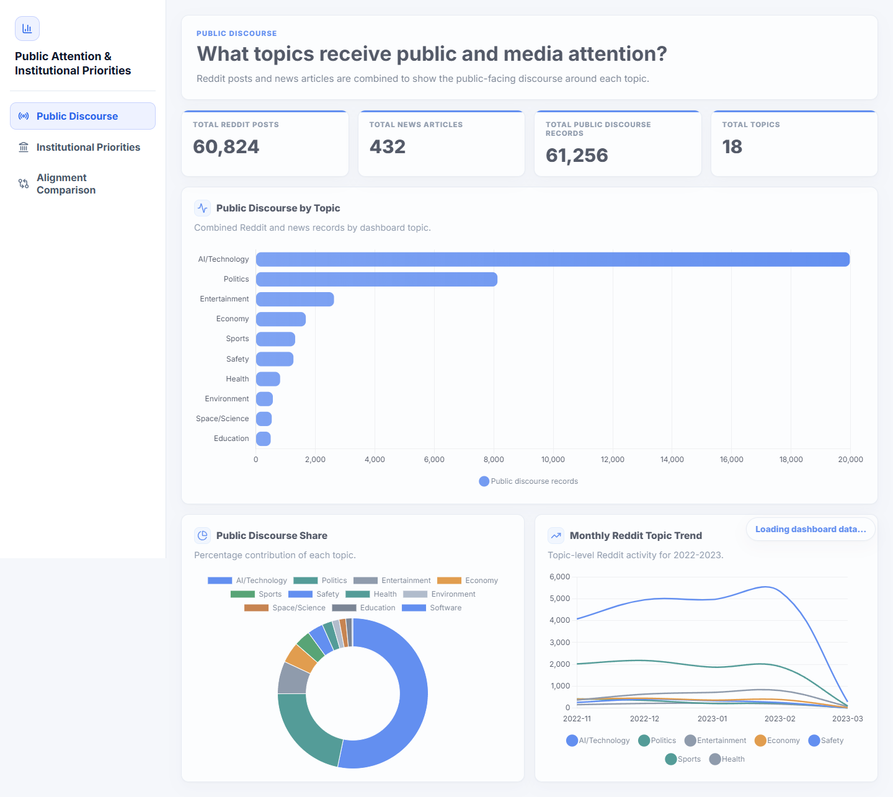
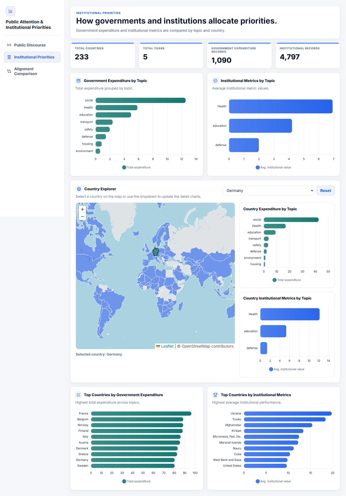
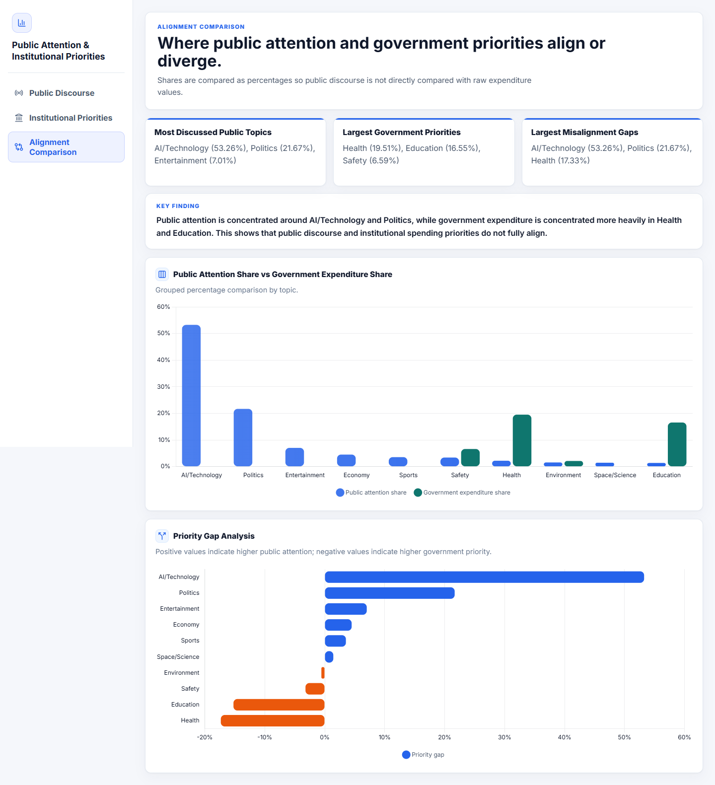

# Public Attention and Institutional Priorities

**A Data Warehouse and Dashboard Analysis**

This project combines data preparation, a MySQL analytical warehouse, and a Flask dashboard. Its central research question is:

> How does public and media attention compare with government expenditure and institutional metrics across topics and countries?

The dashboard is a descriptive comparison, not evidence that public discussion causes policy or budget decisions.

## Dashboard

### Public Discourse
Reddit and news record totals, topic comparison, topic share, and a monthly Reddit topic trend.



### Institutional Priorities
Government expenditure and institutional metrics by topic, an interactive country explorer map, and country rankings.



### Alignment Comparison
Percentage shares of public attention and government expenditure for shared topics, with priority gaps.



*Screenshots were captured from a local run against the author's MySQL database.*

## Key observation

In the data loaded for this project, public attention is concentrated on AI/Technology and Politics, while expenditure is concentrated on Health and Education, so the two do not fully align. Topic labels come from keyword rules in SQL and are not validated subject classifications.

## Project stages

1. **Collection and cleaning** (`preparation/scripts/`): pandas scripts combine raw files, remove duplicates and low-quality records, normalise text, and produce cleaned CSVs.
2. **Warehouse (MySQL):** staging tables load the cleaned data into fact tables (`fact_reddit_posts`, `fact_news_articles`, `fact_government_expenditure`, `fact_institutional_metrics`) and dimension tables (`dim_topics`, `dim_countries`, `dim_time`, `dim_sources`).
3. **Dashboard** (`app.py`): Flask JSON routes run SQL against the warehouse; a single-page UI renders them with Chart.js and Leaflet.

## Technology

Python, Flask, MySQL, `mysql-connector-python`, pandas, Requests, BeautifulSoup, HTML/CSS/JavaScript, Chart.js, and Leaflet.js.

## Data and limitations

The project uses historical Reddit data, news headlines, expenditure data, and institutional metrics. The preparation scripts include headline collection from Hacker News and BBC and institutional indicators from the World Bank API. The exact provenance/licensing of every dataset has not been verified.

**Datasets are intentionally not included.** The raw and cleaned CSVs are large, and Reddit files include author and URL fields. Public redistribution and personal-data suitability have not been established. See [data/README.md](data/README.md) for the files omitted and the existing scripts' expected inputs. Collection scripts can make external requests; they are not run automatically by the dashboard.

The dashboard reads from MySQL; it does not load CSVs directly. The application expects the following warehouse tables:

- Dimensions: `dim_topics`, `dim_countries`, `dim_time`
- Facts: `fact_reddit_posts`, `fact_news_articles`, `fact_government_expenditure`, `fact_institutional_metrics`

This repository contains only the dashboard/analysis queries. The warehouse schema (DDL), staging, and ETL SQL are not included as executable files. **Consequently, this repository cannot create or populate the required warehouse from scratch yet.** Use a compatible, already populated database, or add a schema-only export and load scripts before claiming end-to-end reproducibility. No database setup or destructive SQL is run by this project.

## Architecture and pipeline

```text
Source data / collection scripts
              |
              v
Cleaning and preparation scripts
              |
              v
Staging and warehouse ETL                  [SQL not included]
              |
              v
MySQL fact and dimension tables
              |
              v
Flask API routes -> Chart.js / Leaflet.js dashboard
```

## Repository structure

```text
.
|-- app.py
|-- requirements.txt
|-- .env.example
|-- templates/
|-- static/
|-- preparation/
|   |-- requirements.txt
|   `-- scripts/
|-- sql/
|   `-- dashboard_queries.sql
|-- data/
|   |-- raw/
|   `-- cleaned/
`-- docs/
    `-- screenshots/
```

The Flask app sits at the repository root so its template and static-file paths work. The preparation scripts live in `preparation/scripts/`; they use filenames relative to the current working directory, as described in [data/README.md](data/README.md).

## Prerequisites

- Python 3.8 or newer
- MySQL Server with a compatible, populated warehouse
- A modern browser with network access for the externally hosted Chart.js, Leaflet, and font assets

## Local setup

From the repository root, create and activate a virtual environment, then install the dashboard requirements:

```powershell
py -m venv .venv
.\.venv\Scripts\Activate.ps1
python -m pip install -r requirements.txt
```

Copy `.env.example` to `.env` and set `DB_HOST`, `DB_USER`, `DB_PASSWORD`, and `DB_NAME` for your MySQL instance. `.env` is ignored by Git. The app defaults to `localhost` and a database named `public_discourse`; set `DB_NAME` to your database. Configure the account with only the access it needs.

Before launching, ensure the selected database already has the expected tables and compatible columns/data. This repository does not currently include the DDL or ETL needed to create them. The available [dashboard SQL](sql/dashboard_queries.sql) contains analytical queries only; it is not a schema installer.

Start the local development server:

```powershell
python app.py
```

Open <http://127.0.0.1:5000/>. Dashboard data requests require the MySQL database to be reachable. The included Flask development server is for local use, not production deployment.

### Optional: prepare data

The data preparation scripts have their own dependencies; install them only if you are working with their source files:

```powershell
python -m pip install -r preparation/requirements.txt
```

See [data/README.md](data/README.md) before running them. Some scripts collect from external services, and no sample data is included.

## Known limitations and next steps

- Add a schema-only export and ETL scripts for the warehouse, then document and test a reproducible import into a fresh local database.
- Review data-source terms and personal-data implications before publishing any CSVs.
- Document dataset versions, collection dates, and the institutional metrics/expenditure sources.
- The dashboard's topic labels are based on the existing project logic and should not be interpreted as validated subject classifications.
- Browser charts depend on CDN-hosted libraries and fonts.

## Validation status

The dashboard was run locally against the author's populated MySQL warehouse, and its API routes returned successfully. Creating the warehouse from this repository alone has not been tested, and no automated test suite is included.
